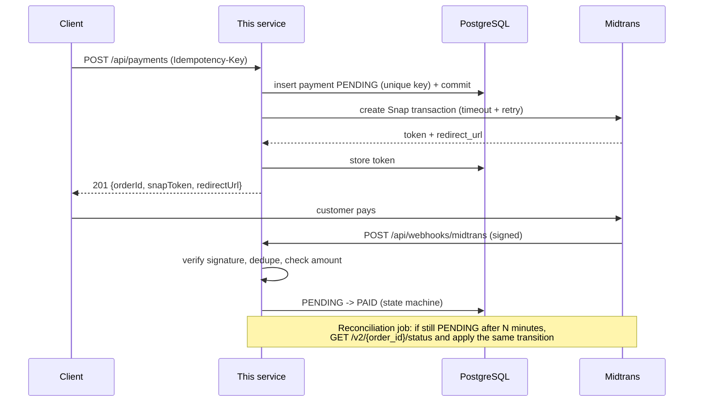

# Payment Gateway Integration (Midtrans) — Spring Boot

A small, production-minded reference service for accepting payments through
[Midtrans Snap](https://docs.midtrans.com/) (sandbox). It focuses on the parts that usually go
wrong in real integrations: **duplicate charges, forged or replayed webhooks, out-of-order
notifications, and lost notifications.**

**Stack:** Java 21 · Spring Boot 3.3 · PostgreSQL · Flyway · Docker Compose · GitHub Actions

## What it demonstrates

| Problem | How it is handled |
|---|---|
| Client retries create a second charge | `Idempotency-Key` header, enforced by a unique DB constraint. Replays return the original payment (`200` + `Idempotent-Replayed: true`); same key with a different body returns `422`. |
| Forged webhook | `SHA512(order_id + status_code + gross_amount + server_key)` verified with a constant-time comparison. Invalid signature returns `401` and nothing is written. |
| Webhook delivered twice (or concurrently) | Every verified event is stored under a unique event key; redelivery is a no-op. |
| Webhook arrives out of order (`pending` after `settlement`) | Forward-only state machine (`PaymentStatus.canTransitionTo`); a paid payment can only move to `REFUNDED`. |
| Amount tampering / mismatch | Webhook `gross_amount` must equal the stored amount, otherwise the event is logged and ignored. |
| Midtrans is slow or down | Timeouts, retries with exponential backoff + jitter (network errors, `429`, `5xx` only). No DB transaction is held during the HTTP call. |
| Webhook never arrives | A scheduled reconciliation job polls the Midtrans status API for stale `PENDING` payments and applies the same state machine. |
| Concurrent webhook + reconciliation update | Optimistic locking (`@Version`); the loser gets `409` and Midtrans redelivers. |

## Flow



## Run it

Prerequisites: Docker, and a Midtrans **sandbox** account for the server key
(Dashboard > Settings > Access Keys).

```bash
cp .env.example .env        # put your SB-Mid-server-... key in it
docker compose up --build
```

- Swagger UI: http://localhost:8080/swagger-ui.html
- Health: http://localhost:8080/actuator/health

Without Docker: start any PostgreSQL 16, set `MIDTRANS_SERVER_KEY` (and `DB_URL`, `DB_USER`,
`DB_PASSWORD` if they differ from the defaults), then `mvn spring-boot:run`.

## Try it

```bash
# 1. create a payment
curl -i -X POST http://localhost:8080/api/payments \
  -H "Content-Type: application/json" \
  -H "Idempotency-Key: demo-0001" \
  -d '{"amount": 150000, "customerName": "Budi", "customerEmail": "budi@example.com"}'

# 2. repeat the exact same call: same payment comes back, no second charge
#    (200 OK + Idempotent-Replayed: true)

# 3. open redirect_url from the response and pay with a sandbox test method
#    (https://docs.midtrans.com/docs/testing-payment-on-sandbox)

# 4. check status
curl http://localhost:8080/api/payments/<orderId>
```

**Receiving real webhooks locally:** expose port 8080 (e.g. `ngrok http 8080`) and set the
*Payment Notification URL* in the Midtrans sandbox dashboard (Settings > Configuration) to
`https://<your-tunnel>/api/webhooks/midtrans`. Even without it, the reconciliation job will pick up
the final status after `reconciliation.pending-older-than-minutes` (default 5).

## API

| Method | Path | Notes |
|---|---|---|
| `POST` | `/api/payments` | Header `Idempotency-Key` required. `201` created, `200` replay, `422` key reused with a different body, `502` provider unavailable. |
| `GET` | `/api/payments/{orderId}` | Current status. |
| `POST` | `/api/webhooks/midtrans` | Called by Midtrans. `401` on bad signature. |

Errors use RFC 7807 problem responses.

## Project layout

```
src/main/java/dev/fahtur/payments
├── domain/      Payment, PaymentStatus (state machine), WebhookEvent
├── midtrans/    MidtransClient (timeouts + retry), SignatureVerifier, status mapper
├── service/     PaymentService, WebhookService, ReconciliationJob
├── web/         controller, DTOs, exception handler
└── repo/        Spring Data repositories
src/main/resources/db/migration/V1__init.sql
```

## Tests

```bash
mvn verify
```

Unit tests cover signature verification (valid, tampered, wrong key, missing fields), the Midtrans
status mapping, and the payment state machine (including late webhooks).

## Design notes and known limits

- **Failed create is final.** If Midtrans cannot be reached after all retries, the payment is
  marked `FAILED` and the client must retry with a *new* Idempotency-Key. Midtrans rejects a reused
  `order_id`, so silently re-sending the same order could not be made safe.
- **Orphan cleanup.** If the process dies between "insert payment" and "call Midtrans",
  reconciliation sees Midtrans answer `status_code: "404"` (Midtrans returns HTTP 200 with that code
  in the body) and fails the payment after `reconciliation.orphan-after-minutes`.
- **Partial refunds** are collapsed into `REFUNDED` to keep the state machine small.
- **Not included (on purpose):** authentication on `POST /api/payments` (put it behind your API
  gateway or add Spring Security), distributed locking for the reconciliation job (e.g. ShedLock
  when running many instances), metrics/alerting, and integration tests with Testcontainers.
- Amounts are integers in IDR (no decimals), stored as `BIGINT`.
